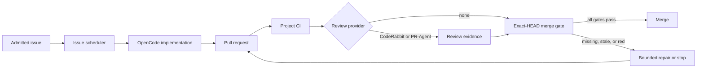

# Continuum

[English](README.md) | [Русский](README.ru.md)

**Turn an admitted GitHub issue into a reviewed pull request — and merge it only
when the exact current HEAD passes the gates you configured.**

Continuum is a reusable GitHub Actions control plane for autonomous
implementation with explicit human admission, pull-request-only writes, and
merge gates you can audit. It is not a hosted service and it does not replace
GitHub Actions: you install a small set of named caller workflows, and the
engine stays in this repository.

**[Start the Quick Start →](docs/quickstart.md)** — a copy-paste walkthrough for
one disposable test repository, including the negative check that an
unadmitted issue is not dispatched.

## Why use it

- **You stay in control of what starts.** Set `AUTOMATION_READY_LABEL` (for
  example `automation:ready`) and only issues carrying that label are picked
  up automatically. While the variable is empty, the scheduler may enqueue any
  eligible open issue — configure it before the first issue.
- **Automation cannot write to `main` directly.** Implementation happens on a
  branch and is published through a pull request, then repaired within a
  bounded loop when CI or review finds a problem.
- **Merge is tied to evidence, not to a green-looking run.** CI and review
  evidence must belong to the exact pull-request HEAD; moved, stale, or missing
  evidence blocks the merge.
- **Your CI stays yours.** One project-owned `ci.yml` named `CI` calls the
  shared validation engine and keeps your toolchain decisions.
- **Review providers are optional.** Use CodeRabbit, the optional PR-Agent
  stack, or no review provider at all.
- **Multi-repository work is an advanced opt-in.** Parent/child delegation is
  installed only after the single-repository path works.

Free anonymous OpenCode models are the default. They can be rate-limited,
unavailable, or changed by their provider, so no uptime, latency, reliability,
or cost guarantee is offered. See
[status and limitations](docs/technical-overview.md#status-and-limitations).

## How it works

In prose: the scheduler admits an eligible issue, OpenCode implements it on a
branch and opens a pull request, your `CI` workflow validates that HEAD,
optional review adds its own evidence, and the merge gate merges only when every
configured gate still passes for the same HEAD. A failure stops at the gate or
enters the bounded repair path; a green result is never guaranteed.

## Who it is for

Maintainers of GitHub repositories who are comfortable with GitHub Actions,
YAML, repository variables and secrets, and branch protection — and who want
autonomous work without accepting direct writes to `main` or unattributable
merges. Start with **one repository**. Parent/child delegated execution is an
optional advanced layer, not a prerequisite.

## Connect it to a repository

1. **Prepare a disposable repository** with Actions enabled and a branch to
   protect, normally `main`.
2. **Inspect and pin** `install.sh` to a reviewed branch, tag, or full commit
   SHA.
3. **Install the core callers** (`core` set). The installer never edits your
   project-owned `ci.yml`.
4. **Add the required secrets and admission label** — at minimum `TAP_PAT`
   (classic PAT with `repo` + `workflow`) and
   `AUTOMATION_READY_LABEL=automation:ready`.
5. **Protect `main`** with required pull requests, required current-HEAD
   checks, no routine bypass, and blocked force pushes and deletion.
6. **Run the negative check first**, then admit one harmless issue and follow it
   through the run, pull request, CI, optional review, and merge.

The exact commands, expected observations, and cleanup steps are in the
[Quick Start](docs/quickstart.md).

## Documentation

All user guides linked here are available in English and Russian. This README
links the English edition; each guide has its own `English | Русский` switch.

| Guide | What it answers |
| --- | --- |
| [Quick Start](docs/quickstart.md) | How do I prove the lifecycle safely in a fresh test repository? |
| [Technical overview](docs/technical-overview.md) | How is Continuum built, installed, upgraded, and diagnosed? |
| [Consumer configuration variables](docs/consumer-variables.md) | Which setting do I use, what is its real default, and what does it change? |
| [Parent/child delegated execution](docs/parent-child-delegation.md) | How do I run work for child repositories from a parent? |
| [Contract qualification](docs/contract-qualification.md) | What evidence is required before a merge, and where is `main` protected? |
| [Optional periodic wake](docs/cron-job-org.md) | How do I add a manual scheduler backstop after merge? |
| [Release workflow reference templates](docs/release-templates.md) | What historical material exists, and why is it inactive? |

## Requirements and safety

- A GitHub repository with Actions enabled and permission to add workflows.
- A **classic** personal access token with `repo` + `workflow` scopes, stored as
  `TAP_PAT`.
- Branch protection for `main`: required pull requests, required current-HEAD
  checks, no routine bypass, and force-push/deletion blocked. Continuum cannot
  protect `main` by itself.
- Linux on `ubuntu-latest` is the qualified default runner. Do not assume macOS
  or Windows hosted-cache support.
- Core workflows use free anonymous OpenCode models and never require a paid
  provider key.

Start with a disposable repository and no valuable open issues. The
[safety model](docs/technical-overview.md#safety-model),
[status and limitations](docs/technical-overview.md#status-and-limitations), and
[what has been live-qualified](docs/technical-overview.md#what-has-been-live-qualified)
are documented in full.

## Secrets and variables

| Secret | Required when | Purpose |
| --- | --- | --- |
| `TAP_PAT` | Lifecycle workflows need authenticated GitHub writes | Classic PAT with `repo` + `workflow` scopes. |
| `RENDER_API_KEY` | Render execution is enabled | Render-only API credential with no fallback to `TAP_PAT`. |
| `CHILD_RUNTIME_TOKEN` | Parent callers invoke a child workflow | Delegated child access; parent callers map it from the parent's `TAP_PAT`. |
| `CHILD_RUNTIME_REPOSITORIES` | Legacy parent configuration only | Compatibility path for pre-variable child relationships. |
| `CONTINUUM_VERIFICATION_ATTESTATION_KEY` | Optional signed resumable verification evidence | HMAC-SHA256 key used only by the runner-side verification engine. |

Core workflows do not use paid provider keys (`OPENCODE_API_KEY`,
`ANTHROPIC_API_KEY`, `GROQ_API_KEY`, or `GROQ.KEY`) and run on free anonymous
models. No workflow reads them to authenticate; the optional PR-Agent canary
reads the `OPENCODE_API_KEY`, `ANTHROPIC_API_KEY`, and `GROQ_API_KEY` repository
variables only to reject the run if any is set. `secrets.GITHUB_TOKEN` is
minted by GitHub automatically. The
[technical overview](docs/technical-overview.md#secrets-and-variables) explains
each entry, the verification-key provisioning path, and the full repository
variable defaults.

Repository variables: `AUTOMATION_READY_LABEL` controls admission and
`CONTINUUM_REVIEW_PROVIDER` selects `none`, `coderabbit`, or `pr-agent`. The
[scheduler and review variables](docs/technical-overview.md#secrets-and-variables)
and the [consumer variables reference](docs/consumer-variables.md) cover the
rest.

## Status and license

Continuum is under active development and offers no SLA.

Continuum is **source-available**, not OSI-approved open source, under the
[Business Source License 1.1](LICENSE) (SPDX: `BUSL-1.1`). Non-production use is
allowed; the additional production-use grant is limited to noncommercial
purposes and must not provide a competing product or service. Each version
converts to the Apache License 2.0 on its Change Date; the [license
text](LICENSE) is authoritative.
