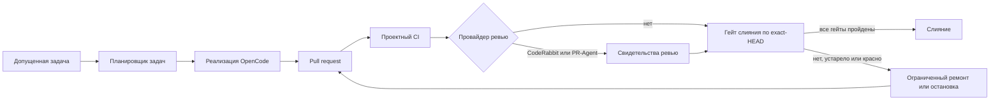

# Continuum

[English](README.md) | [Русский](README.ru.md)

**Continuum превращает допущенную задачу GitHub в проверенный pull request и
сливает его только тогда, когда точный текущий HEAD проходит заданные вами
гейты.**

Это переиспользуемая плоскость управления GitHub Actions для автономной
реализации с явным допуском человеком, записью только через pull request и
гейтами слияния, которые можно аудировать. Continuum — не хостинговый сервис и
не замена GitHub Actions: вы устанавливаете небольшой набор именованных
workflow-вызывателей, а движок остаётся в этом репозитории.

**[Открыть Quick Start →](docs/quickstart.ru.md)** — пошаговая инструкция с
готовыми к копированию командами для одного одноразового тестового репозитория,
включая негативную проверку: задача без допуска не должна запускаться.

## Зачем это нужно

- **Вы решаете, что начинается.** Задайте `AUTOMATION_READY_LABEL` (например,
  `automation:ready`), и автоматически берутся только задачи с этой меткой.
  Пока переменная пуста, планировщик может поставить в очередь любую подходящую
  открытую задачу — настройте метку до первой задачи.
- **Автоматизация не пишет в `main` напрямую.** Реализация идёт в ветке и
  публикуется через pull request, а замечания CI или ревью обрабатывает
  ограниченный цикл исправлений.
- **Слияние опирается на свидетельства, а не на «зелёный» запуск.** Данные CI и
  ревью должны относиться к точному HEAD pull request; устаревшие,
  отсутствующие или красные свидетельства блокируют слияние.
- **Ваш CI остаётся вашим.** Один проектный `ci.yml` с именем `CI` вызывает
  общий движок валидации и сохраняет решения о вашем toolchain.
- **Провайдер ревью необязателен.** CodeRabbit, необязательный стек PR-Agent или
  полное отсутствие провайдера ревью.
- **Работа с несколькими репозиториями — продвинутый режим, включаемый по
  желанию.** Делегация parent/child устанавливается только после того, как
  работает сценарий с одним репозиторием.

По умолчанию используются бесплатные анонимные модели OpenCode. Они могут быть
ограничены по частоте, недоступны или изменены провайдером, поэтому гарантий
доступности, задержки, надёжности или стоимости нет. См.
[статус и ограничения](docs/technical-overview.ru.md#статус-и-ограничения).

## Как это работает

Словами: планировщик допускает подходящую задачу, OpenCode реализует её в ветке
и открывает pull request, ваш workflow `CI` проверяет этот HEAD, необязательное
ревью добавляет свои свидетельства, а гейт слияния выполняет merge только если
все настроенные гейты по-прежнему проходят для того же HEAD. Сбой останавливает
процесс на гейте или запускает ограниченный ремонт; успешный результат не
гарантируется.

## Для кого это

Для мейнтейнеров репозиториев GitHub, которые уверенно работают с GitHub
Actions, YAML, переменными и секретами репозитория и защитой веток — и хотят
автономную работу без прямых записей в `main` и без слияний, которые нельзя
проверить. Начинайте с **одного репозитория**. Делегация parent/child — это
необязательный продвинутый слой, а не обязательное условие.

## Подключение к репозиторию

1. **Подготовьте одноразовый репозиторий** с включёнными Actions и веткой,
   которую нужно защитить, обычно `main`.
2. **Изучите и закрепите** `install.sh` на проверенной ветке, теге или полном
   SHA коммита.
3. **Установите core-вызыватели** (набор `core`). Установщик никогда не правит
   ваш проектный `ci.yml`.
4. **Добавьте обязательные секреты и метку допуска** — как минимум `TAP_PAT`
   (классический PAT со scopes `repo` + `workflow`) и
   `AUTOMATION_READY_LABEL=automation:ready`.
5. **Защитите `main`**: обязательные pull request, обязательные проверки
   текущего HEAD, запрет обычного обхода, блокировка force-push и удаления.
6. **Сначала выполните негативную проверку**, затем допустите одну безобидную
   задачу и проследите её путь через запуск, pull request, CI, необязательное
   ревью и слияние.

Точные команды, ожидаемые наблюдения и шаги очистки —
в [Quick Start](docs/quickstart.ru.md).

## Документация

Все руководства, на которые ссылается этот README, доступны на английском и
русском. Этот README ссылается на русское издание; у каждого руководства есть
переключатель `English | Русский`.

| Руководство | На какой вопрос отвечает |
| --- | --- |
| [Quick Start](docs/quickstart.ru.md) | Как безопасно проверить жизненный цикл в новом тестовом репозитории? |
| [Технический обзор](docs/technical-overview.ru.md) | Как Continuum устроен, устанавливается, обновляется и диагностируется? |
| [Переменные конфигурации потребителя](docs/consumer-variables.ru.md) | Какую настройку использовать, какое у неё реальное значение по умолчанию и что она меняет? |
| [Делегированное выполнение parent/child](docs/parent-child-delegation.ru.md) | Как выполнять работу дочерних репозиториев из родительского? |
| [Квалификация контракта](docs/contract-qualification.ru.md) | Какие свидетельства нужны до слияния и как защищён `main`? |
| [Необязательный внешний запуск по расписанию](docs/cron-job-org.ru.md) | Как добавить ручной резервный запуск планировщика после merge? |
| [Справочные шаблоны release-workflow](docs/release-templates.ru.md) | Какой исторический материал существует и почему он неактивен? |

## Требования и безопасность

- Репозиторий GitHub с включёнными Actions и правом добавлять workflows.
- **Классический** personal access token со scopes `repo` + `workflow`,
  сохранённый как `TAP_PAT`.
- Защита ветки `main`: обязательные pull request, обязательные проверки
  текущего HEAD, запрет обычного обхода и блокировка force-push/удаления.
  Сам Continuum не может защитить `main`.
- Проверенный раннер по умолчанию — Linux на `ubuntu-latest`. Не рассчитывайте
  на поддержку hosted-cache в macOS или Windows.
- Core-workflows используют бесплатные анонимные модели OpenCode и никогда не
  требуют платный ключ провайдера.

Начинайте с одноразового репозитория без ценных открытых задач. Полностью
описаны [модель безопасности](docs/technical-overview.ru.md#модель-безопасности),
[статус и ограничения](docs/technical-overview.ru.md#статус-и-ограничения) и
[что проверено в реальных условиях](docs/technical-overview.ru.md#что-проверено-в-реальных-условиях).

## Секреты и переменные

| Секрет | Когда требуется | Назначение |
| --- | --- | --- |
| `TAP_PAT` | Lifecycle-workflows нужны аутентифицированные записи в GitHub | Классический PAT со scopes `repo` + `workflow`. |
| `RENDER_API_KEY` | Включено выполнение через Render | API-ключ только для Render, без запасного варианта через `TAP_PAT`. |
| `CHILD_RUNTIME_TOKEN` | Parent callers вызывают workflow дочернего репозитория | Доступ к делегированному дочернему репозиторию; parent callers берут его из собственного `TAP_PAT`. |
| `CHILD_RUNTIME_REPOSITORIES` | Только для устаревшей конфигурации parent | Путь совместимости для связей дочерних репозиториев, задававшихся до появления переменных. |
| `CONTINUUM_VERIFICATION_ATTESTATION_KEY` | Необязательные подписанные возобновляемые свидетельства проверки | Ключ HMAC-SHA256, используемый только движком проверки на раннере. |

Core-workflows не используют платные ключи провайдеров (`OPENCODE_API_KEY`,
`ANTHROPIC_API_KEY`, `GROQ_API_KEY` или `GROQ.KEY`) и работают на бесплатных
анонимных моделях. Ни один workflow не читает их для аутентификации;
необязательный canary PR-Agent читает переменные репозитория `OPENCODE_API_KEY`,
`ANTHROPIC_API_KEY` и `GROQ_API_KEY` только чтобы отклонить запуск, если какая-либо
из них задана. `secrets.GITHUB_TOKEN` создаётся GitHub автоматически.
[Технический обзор](docs/technical-overview.ru.md#секреты-и-переменные)
описывает каждый пункт, порядок подготовки ключа проверки и значения по
умолчанию для переменных репозитория.

Переменные репозитория: `AUTOMATION_READY_LABEL` управляет допуском, а
`CONTINUUM_REVIEW_PROVIDER` выбирает `none`, `coderabbit` или `pr-agent`.
Остальные описаны в
[разделе о переменных планировщика и ревью](docs/technical-overview.ru.md#секреты-и-переменные)
и в [справочнике переменных потребителя](docs/consumer-variables.ru.md).

## Статус и лицензия

Continuum активно развивается и не предоставляет SLA.

Continuum распространяется как **source-available**, а не как open source,
одобренный OSI, по [Business Source License 1.1](LICENSE) (SPDX: `BUSL-1.1`).
Использование вне production разрешено; дополнительное разрешение на
production-использование ограничено некоммерческими целями и не должно
предоставлять конкурирующий продукт или сервис. Каждая версия переходит на
Apache License 2.0 в свою Change Date; юридическую силу имеет
[текст лицензии](LICENSE).
