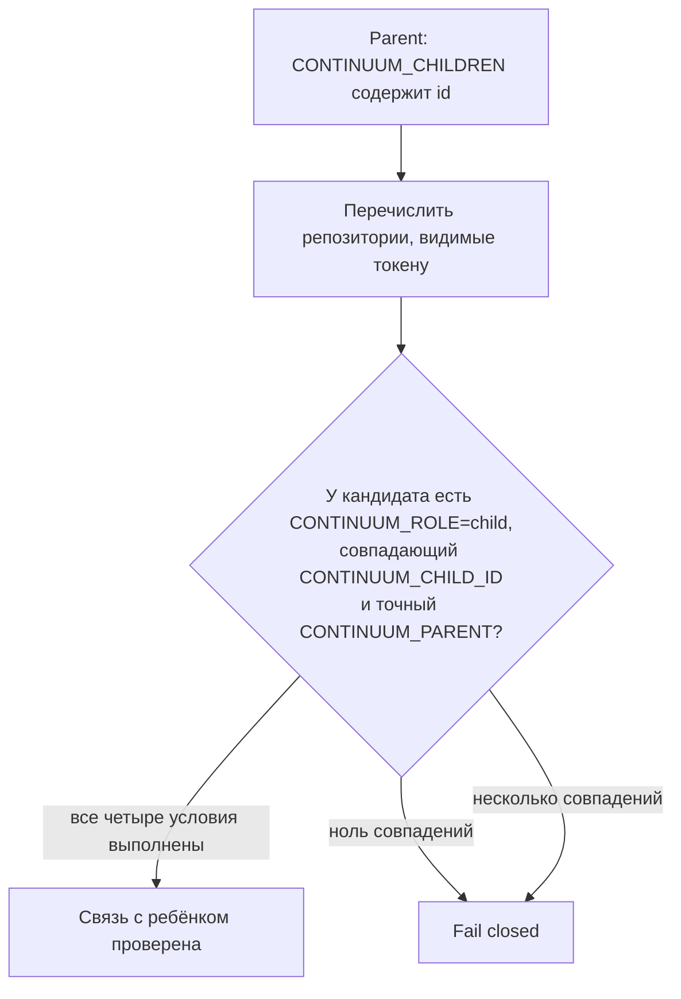

# Делегированное выполнение parent/child

[English](parent-child-delegation.md) | [Русский](parent-child-delegation.ru.md)

Continuum может выполнять работу для дочернего репозитория из родительского,
не рассматривая публичную/приватную видимость как роль.

## Хранение связей

Конкретные значения связей живут в **переменных репозитория** GitHub Actions, а
не в отслеживаемых файлах репозитория.

Переменные родительского репозитория:

- `CONTINUUM_ROLE=parent`
- `CONTINUUM_CHILDREN` — JSON-массив непрозрачных id детей, например
  `["child-a","child-b"]`

Переменные дочернего репозитория:

- `CONTINUUM_ROLE=child`
- `CONTINUUM_CHILD_ID` — id, присутствующий в `CONTINUUM_CHILDREN` родителя
- `CONTINUUM_PARENT` — точное имя `owner/repository` родителя
- `CONTINUUM_VALIDATION_SCRIPT` — необязательный путь к `.sh` внутри
  репозитория для детерминированной валидации

Отслеживаемому `.continuum.yml` репозитория не нужно содержать роль, список
детей, id ребёнка или имя родителя. Достаточно нейтрального файла:

```yaml
version: 1
```

Это держит конкретные связи parent/child вне исходного дерева. Тонкие
parent-workflows не передают значения связей как входы workflow или переменные
окружения задачи. Runtime Continuum читает переменные Actions вызывающего
репозитория напрямую через GitHub API внутри раннера.

## Обнаружение и двусторонняя проверка



Родитель использует свой runtime-токен, чтобы перечислить репозитории,
принадлежащие владельцу токена, **без фильтра видимости**. Для каждого
кандидата он читает переменные репозитория GitHub Actions и принимает
репозиторий, только когда выполнены все условия:

1. запрошенный id ребёнка присутствует в `CONTINUUM_CHILDREN` родителя;
2. у кандидата `CONTINUUM_ROLE=child`;
3. его `CONTINUUM_CHILD_ID` равен запрошенному id;
4. его `CONTINUUM_PARENT` точно равен вызывающему родительскому репозиторию.

Ноль совпадений или несколько совпадений завершаются fail-closed. Видимость
репозитория никогда не является сигналом маршрутизации.

## Семантика сбоев

Обнаружение отличает недоступный GitHub API от неправильно настроенной связи.
Когда API недоступен или отказывает в запросе (например, когда шторм
пробуждений после завершения исчерпывает бюджет запросов токена), разрешение
завершается с `Delegated child discovery is unavailable; refusing to guess`
вместо вердикта проверки. Настоящее отсутствие совпадений или неоднозначное
совпадение сохраняют собственную fail-closed ошибку. Сырые ошибки API никогда
не выводятся: они содержат URL запросов, которые раскрыли бы имя приватного
дочернего репозитория в публичных логах родителя. Планировщик пробуждается
заново по своим обычным триггерам, поэтому запуск, завершившийся
«недоступно», детерминированно повторяется после сброса бюджета, разрешая того
же настроенного ребёнка до и после делегированного завершения.

Старое объявление связей в `.continuum.yml` остаётся читаемым только как путь
совместимости, пока существующие потребители мигрируют. Новые интеграции и
разрешение делегированных целей PR-Agent используют переменные репозитория как
авторитетный контракт связей.

## Parent-workflows

Установите обычный core-вызыватель `continuum-issue-scheduler.yml` плюс тонкие
входные workflows в `.github/caller-stubs/parent/`. Parent-вызыватели вызывают:

- `continuum-consumer-child-worker.yml`
- `continuum-consumer-child-review.yml`
- `continuum-consumer-child-pr-review.yml`
- `continuum-consumer-child-run-cleanup.yml` (только очистка завершённых
  запусков)

Отдельного вызывателя диспетчера parent/child нет. Core-планировщик задач
разрешает проверенные связи детей, сверяет дочерние ревью и объединяет
собственные кандидаты задач родителя с кандидатами задач детей перед обычной
сортировкой по приоритету и лимитом WIP.

Обёртки не передают значения связей parent/child. Continuum читает
`CONTINUUM_ROLE` и `CONTINUUM_CHILDREN` напрямую из родительского репозитория
через GitHub API после старта раннера. Это не даёт раскрыть список детей во
входах переиспользуемого workflow или метаданных окружения задачи. Имя
дочернего репозитория разрешается только внутри раннера и не коммитится в
родительский репозиторий.

Всё равно нужен токен с доступом к дочерним репозиториям через
child-runtime-секрет обёртки.

## Детерминированная валидация ребёнка

Когда в дочернем репозитории задан `CONTINUUM_VALIDATION_SCRIPT`,
делегированное ревью загружает этот скрипт из **базовой ветки** ребёнка, никогда
из HEAD pull request, и выполняет его против рабочего дерева кандидата с
минимальным окружением `env -i`.

GitHub-токены, привязки репозитория и учётные данные моделей не наследуются
процессом валидации проекта. Вывод валидации остаётся локальным для раннера.
Слияние требует и независимого принятия ревью, и успешной детерминированной
валидации.

## Маршрутизация задач на уровне репозитория

Проверенная связь с ребёнком — это и есть решение о маршрутизации. Когда у
репозитория `CONTINUUM_ROLE=child` и его привязка parent/child проходит
двустороннюю проверку, каждая открытая задача в этом ребёнке доступна для
делегированного выполнения родителем. Маркер принадлежности в теле задачи и
метка приоритета не требуются.

Метки приоритета остаются только необязательными метаданными планирования:
когда они есть, `priority:p0`, `priority:p1` и `priority:p2` ставят работу
впереди задач без приоритета. Они никогда не решают, принадлежит ли задача
родителю.

Локальный вызыватель планировщика задач остаётся установленным в дочернем
репозитории. Когда `CONTINUUM_ROLE=child`, переиспользуемый планировщик никогда
не запускает локальную работу; вместо этого событийные запуски вызывателя
проверяют `CONTINUUM_CHILD_ID`, `CONTINUUM_PARENT` и allow-list
`CONTINUUM_CHILDREN` родителя, затем будят проверенный планировщик задач
родителя. Дочерний вызыватель намеренно пропускает свои собственные события
расписания/cron; опрос выполняет запланированная сверка родителя. Файлы
workflows никогда не добавляются и не удаляются при изменении переменных роли
репозитория.

Комментарий владельца репозитория `/oc` или `/opencode` намеренно всё ещё может
запустить существующий локальный workflow OpenCode в ребёнке. Планировщик задач
родителя не запускает делегированного воркера для той же задачи, пока он видит
активный локальный запуск OpenCode, открытый pull request
`opencode/issue<NUMBER>-...` или недавнюю команду владельца внутри настроенного
окна grace для команд.

Точная команда владельца `/oc-cancel` отменяет локальные запуски ребёнка и,
когда роль ребёнка проверена, соответствующий делегированный воркер в
Actions-репозитории Parent. Отмена требует, чтобы `TAP_PAT` ребёнка имел
read/write-доступ к Actions родителя. Устойчивая операторская остановка
остаётся в задаче ребёнка, поэтому планировщик и воркер родителя не
перезапускают это поколение; непрозрачный Child id маскируется в логах. Воркер
родителя, уже использующий устаревший заголовок `SubTask #N`, не может быть
безопасно атрибутирован, и его никогда не угадывают.

## Маршрутизация PR-Agent ребёнка через родителя

Когда `CONTINUUM_REVIEW_PROVIDER=pr-agent`, родитель — единственная
автоматическая плоскость выполнения для дочернего PR-Agent, и на каждого
родителя существует ровно один авторитетный путь ревью:

- провайдер `pr-agent` => lifecycle PR-Agent на стороне родителя. Планировщик
  задач родителя запускает один запуск `continuum-pr-agent-recovery.yml` на
  каждого проверенного ребёнка, неся только непрозрачный id ребёнка;
  reconciler восстановления обнаруживает/допускает каждый подходящий дочерний
  PR в этой цели и запускает ревью/ремонт на стороне родителя с номером PR и
  точным HEAD. Ревью -> ремонт -> повторное ревью -> восстановление
  продолжаются в родителе по мере изменения HEAD детей. Созданные владельцем и
  созданные автоматизацией дочерние PR используют один детерминированный
  маршрут: reconciler допускает каждый открытый нечерновой PR той же цели в том
  же репозитории с зелёным CI на exact-HEAD.
- любое другое значение провайдера => только устаревшее независимое дочернее
  ревью (`continuum-child-review.yml` / `continuum-child-pr-review.yml`).
  Планировщик никогда не запускает устаревшее дочернее ревью рядом с PR-Agent,
  поэтому нет двойного ревью, двойного ремонта или конкурирующего пути
  слияния.

Локальное для ребёнка автоматическое выполнение PR-Agent подавляется в
проверенном режиме child: переиспользуемые workflows `continuum-pr-agent.yml`,
`continuum-pr-agent-repair.yml`, `continuum-pr-agent-auto-merge.yml`,
`continuum-pr-agent-recovery.yml` и `continuum-pr-agent-router.yml` никогда не
выполняются, когда у выполняющего репозитория `CONTINUUM_ROLE=child`, а
вызыватели автоматического восстановления (`continuum-pr-agent-recovery.yml`,
`pr-agent-recovery.yml`) пропускают там события schedule, `pull_request_target`
и `workflow_run`. Явный `workflow_dispatch` владельца в ребёнке всё ещё
доходит до переиспользуемого workflow, который fail-safe переходит к тому же
детерминированному пропуску, поэтому ручное поведение взаимоисключающе с
выполнением родителя, а не соревнуется с ним. Репозитории без роли ребёнка не
затронуты.

Идентичность дедупликации и concurrency стабильна между пробуждениями
планировщика, событий и восстановления: группы ревью, ремонта, слияния и
восстановления ограничивают делегированные запуски непрозрачным id ребёнка
(сохраняя точную локальную строку группы, когда он пуст), ключ операции
маршрутизатора — `review:<child>:<pr>:<head>` при делегации, а lease
восстановления и устойчивые маркеры повтора объединяют дублирующиеся
пробуждения, поэтому дубликаты создают не более одной логической операции на
точный PR/HEAD/операцию. Запуски несут только непрозрачный id ребёнка плюс
номер PR плюс точный HEAD; конкретная идентичность дочернего репозитория
разрешается и перепроверяется только внутри доверенного раннера родителя,
маскируется в логах и никогда не появляется в публичных именах запусков, входах
workflow, артефактах или закоммиченной конфигурации. Устаревшие запуски не
могут отремонтировать или слить более новый HEAD: допуск, повторная проверка,
публикация ремонта и гейт слияния заново проверяют точный HEAD. CodeRabbit
остаётся отдельным и неизменным.

Исторические строки `<!-- continuum-child-owned -->` и
`<!-- runtime-worker-owned -->` могут оставаться в старых телах задач, но они
больше не являются входами маршрутизации.

## Видимость — не маршрутизация

Все эти связи допустимы, когда у учётных данных есть доступ:

- публичный родитель -> приватный ребёнок
- публичный родитель -> публичный ребёнок
- приватный родитель -> приватный ребёнок
- приватный родитель -> публичный ребёнок

Приватность не делает репозиторий ребёнком. Публичность не делает репозиторий
родителем. Это делает только явная связь через переменные репозитория.

## Несколько детей

Один родитель может настроить несколько непрозрачных id детей в
`CONTINUUM_CHILDREN`. У каждого ребёнка независимая привязка репозитория и ключ
concurrency для задач/ревью. Номера задач могут пересекаться между детьми.

Текущий контракт допускает одного родителя на ребёнка. По этому контракту
репозиторий не является одновременно родителем и ребёнком.

## Установка рядом с существующей автоматизацией

У установщика три явных набора:

```sh
# Core task-domain callers: scheduling, review, repair, auto-merge.
bash install.sh /path/to/myapp main core

# Opt-in technology library: the Swift validation profile only
# (`continuum-tech-swift-ci.yml`). It does not install release,
# release-PR, or packaging-smoke callers.
bash install.sh /path/to/myapp main tech

# Parent scheduling is the ordinary core scheduler; parent adds worker/review entry points.
bash install.sh /path/to/parent main core
bash install.sh /path/to/parent main parent
```

Для production замените `main` проверенным полным SHA коммита Continuum. И
`uses:`, и `engine_ref` устанавливаются на эту ревизию. Набор `parent`
устанавливает только `continuum-child-worker.yml`, `continuum-child-review.yml`,
`continuum-child-pr-review.yml` и `continuum-child-run-cleanup.yml`. Обычный
планировщик приходит из набора `core`. Набор `parent` сохраняет существующие
workflows CI, планирования задач, OpenCode, релиза, Render и артефактов. Токен
передаётся через существующий секрет родителя `TAP_PAT`; он должен уметь читать
соответствующие переменные репозитория Actions и работать с выбранными
дочерними репозиториями.

> [!IMPORTANT]
> Сначала установите и проверьте `core`. Набор `parent` добавляет только
> обёртки выполнения детей и не заменяет обычный планировщик.

Core-файлы workflows могут оставаться установленными в дочернем репозитории.
Изменения роли — только конфигурационные: установка или очистка
`CONTINUUM_ROLE=child` никогда не требует удаления, восстановления или
переустановки файлов workflow. Защита дочерней роли локального планировщика
предотвращает автоматическое локальное выполнение задач, сохраняя ручную точку
входа OpenCode.

Планировщик задач родителя использует те же триггеры, что и обычный
core-планировщик, и дополнительно пробуждается при завершении дочерних
workflows задач/ревью. Событие дочернего репозитория, дошедшее до его
установленного вызывателя планировщика, также немедленно будит проверенного
родителя, поэтому новые задачи детей не зависят от доставки запланированных
событий GitHub по принципу best-effort. Cron родителя остаётся страховкой.
Выполнение задач и независимое ревью остаются раздельными; завершённые задачи
не воскрешаются, задачи, заблокированные зависимостями, остаются
заблокированными, а созданные владельцем PR используют workflow независимого
ревью PR.

## Базовая линия миграции

Runtime делегации был восстановлен из коммита Continuum
`7aa2aec38a97a2639e96a2f2e1168b0571afcc0d`, уже используемого Runtime Lab.
Реализация воркера соответствует отдельно закреплённой версии
`954aa575ab385b6785f6923937fceb7ec108c966`. Это сохраняет существующее
поведение восстановления и ревью, делая эти точки входа доступными рядом с
workflows потребителя.

Два guard резолвера ужесточены: невалидное объявление родителя проваливает
план, а явные переменные ребёнка не могут откатиться к конфликтующему
устаревшему файлу. Устаревшие файлы остаются поддерживаемыми, когда переменные
связей отсутствуют.

Эта миграция намеренно оставляет lifecycle Render, синхронизацию знаний,
доставку артефактов, обработку конфликтов публикации, контекст статуса CI и
локальные контроллеры ремонта Runtime Lab в Runtime Lab. У них другие
контракты, чем у специфичной для потребителя сборки macOS и автоматизации
релиза. Общая граница для этой первой интеграции — делегированное выполнение;
более поздняя миграция сможет извлечь те другие контроллеры вместе с их
существующими тестами.

Workflows воркера и ревью теперь выбирают Python явно через необязательный вход
`python_version` (по умолчанию `3.12`). Вызыватели могут переопределить его, не
меняя общий движок. Это делает валидацию ребёнка независимой от значений
Python по умолчанию в образе раннера.

## Очистка публичных делегированных запусков

Слой parent устанавливает `continuum-child-run-cleanup.yml`. Он слушает только
завершённые запуски `SubTask`, `SubTask review` и `SubTask PR review` и удаляет
этот завершённый запуск через GitHub Actions API. Сам workflow очистки не
содержит привязки дочернего репозитория; идентичность репозитория остаётся в
настроенном приватном сопоставлении, а не в устойчивых публичных логах
запусков.
