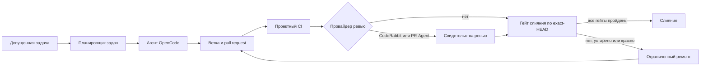

# Технический обзор Continuum

[English](technical-overview.md) | [Русский](technical-overview.ru.md)

Это полный технический справочник по Continuum. Краткая отправная точка —
[README](../README.ru.md), который также ссылается на
[Quick Start](quickstart.ru.md).

Continuum — переиспользуемая **плоскость управления GitHub Actions для
автономной работы «задача → PR» с гейтами**. Она превращает допущенную задачу в
проверенный pull request и сливает его только тогда, когда текущий HEAD
проходит настроенные гейты:

```text
допущенная задача -> планировщик -> реализация OpenCode -> pull request
      -> CI -> необязательное ревью -> ремонт / повторное ревью -> гейт exact-HEAD -> merge
```

Continuum — не хостинговый сервис и не замена GitHub Actions. Это набор
переиспользуемых workflows `workflow_call` плюс тонкие вызыватели
`continuum-*.yml`, которые вы устанавливаете в репозиторий. Реализация живёт в
этом репозитории; репозитории потребителей хранят только файлы вызывателей,
свой `ci.yml` и свою конфигурацию проекта.

**Для кого это:** для мейнтейнеров репозиториев GitHub, которым нужна
автономная реализация с явным допуском человеком, записью только через pull
request и гейтами слияния, которые можно аудировать. Понадобится уверенная
работа с GitHub Actions, YAML, переменными и секретами репозитория и защитой
веток.

**Начинайте с одного репозитория.** Установка в один репозиторий — базовый
сценарий. Делегированное выполнение parent/child — продвинутый необязательный
слой.

## Предварительные требования

- Репозиторий GitHub с включёнными Actions и правом добавлять workflows.
- Раннер. Ядро по умолчанию использует `ubuntu-latest`; поддерживаемое значение
  по умолчанию — Linux. Использование hosted-раннеров GitHub может расходовать
  минуты GitHub Actions в зависимости от вашего плана.
- **Классический** personal access token, сохранённый как `TAP_PAT`, со scopes
  `repo` и `workflow`, для lifecycle-workflows, которым нужны
  аутентифицированные записи в GitHub.
- Защита веток (рекомендуется и требуется для заявленной модели безопасности):
  никаких прямых push в `main`, обязательные pull request, обязательные
  проверки текущего HEAD, запрет обычного обхода, блокировка force-push и
  удаления.
- Необязательный провайдер ревью: CodeRabbit или необязательный стек PR-Agent
  Continuum. Платный ключ провайдера не входит в core-контракт.
- Необязательный `RENDER_API_KEY`, только если вы включаете контроллер
  выполнения Render.

## Статус и ограничения

- Это source-available автоматизация в активной разработке. SLA по
  доступности, задержке, надёжности или стоимости нет.
- Core-workflows рассчитаны на бесплатные анонимные модели OpenCode. Бесплатные
  маршруты могут быть ограничены по частоте, недоступны или изменены
  провайдером; это не гарантия нулевой стоимости или постоянной доступности.
- Linux — проверенный hosted-раннер по умолчанию. Не рассчитывайте на
  поддержку hosted-cache в macOS или Windows.
- Не все маршруты ревью и кодирования одинаково проверены. Перед тем как
  полагаться на маршрут в production, см.
  [что проверено в реальных условиях](#что-проверено-в-реальных-условиях).
- Continuum не может защитить `main` сам по себе. Серверная защита ветки и
  контроль доступа к репозиторию остаются вашей ответственностью.
- Инструкция первого запуска — воспроизводимая процедура, а не утверждение, что
  в этом поколении репозитория выполнялся внешний запуск в песочнице.

## Модель безопасности

> [!IMPORTANT]
> Задайте `AUTOMATION_READY_LABEL` (например, `automation:ready`) **до открытия
> задач**. Пока переменная пуста, планировщик сохраняет историческое поведение
> и может поставить в очередь любую подходящую открытую задачу.

1. **Допуск человеком явный.** Когда переменная задана, планировщик
   автоматически запускает только задачи с этой меткой. Запуск квалификации и
   ручная команда владельца `/oc` метку не требуют.
2. **Автоматизация пишет через pull request.** Установленные workflows создают
   ветки и PR; они не выполняют push напрямую в `main`.
3. **Каждое слияние — по exact-HEAD.** Свидетельства CI и ревью должны
   относиться к текущему HEAD PR. Перемещение HEAD делает старые свидетельства
   недействительными.
4. **Ремонт ограничен.** Падающий CI или неразрешённое замечание ревью может
   запустить ограниченный путь ремонта, после которого выполняются свежие CI и
   ревью. Ни один путь не гарантирует, что ревью всегда одобрит изменения или
   что ремонт всегда завершится успешно.
5. **Учётные данные именованы и ограничены.** `TAP_PAT` — lifecycle-учётные
   данные; `RENDER_API_KEY` — отдельные учётные данные только для Render.
   Никогда не добавляйте платный ключ провайдера в ядро.
6. **Отмена владельцем устойчива.** Владелец репозитория может опубликовать
   точную команду `/oc-cancel` первой значимой строкой обычной задачи, чтобы
   остановить активное поколение реализации этой задачи. Continuum записывает
   устойчивую операторскую остановку до отмены запусков с проверенным
   происхождением, включая проверенного Child-воркера в Actions-репозитории
   Parent. Смена метки или автоматический повтор её не перевзводят; это делает
   только последующее доверенное возобновление оператором или новое
   авторизованное поколение.
7. **Сначала используйте изолированный тестовый репозиторий.** Начинайте с
   одноразового репозитория без ценных открытых задач, особенно пока
   настраиваете метки и раннеры.

### Восстановление владельцем после предварительного условия

Задачу, приостановленную из-за инфраструктурного сбоя, можно освободить одной
строкой-маркером, написанной владельцем в этой задаче:

```html
<!-- continuum-resume-after:v1 predecessor=374 -->
```

Перед публикацией маркера задайте `AUTOMATION_READY_LABEL` (например,
`automation:ready`) и примените эту точную метку вместе с `automation:paused` к
задаче. Восстановление владельцем выбирает только приостановленные задачи с
настроенной меткой готовности, поэтому требуется непустой
`AUTOMATION_READY_LABEL` и метка на задаче; одни только метки на задаче не
подходят, пока переменная пуста.

Строка должна быть первой строкой комментария владельца репозитория, как его
представляет GitHub API; бот, участник, модель или упоминание только в тексте не
могут её взвести. Маркер — это метаданные, а не команда OpenCode. Он
авторизует только собственную приостановленную цель с меткой готовности и только
после того, как указанная задача-предшественник закрыта как выполненная через
связанный pull request реализации, который действительно слит в ветку по
умолчанию с exact-HEAD свидетельствами `CI`, Contract Gate и независимого
чистого ревью. Core-вызыватель `CI` не предоставляет этот гейт, поэтому
настройте
[обязательный workflow Contract Gate](consumer-variables.ru.md#обязательный-workflow-contract-gate)
до запуска PR-предшественника; его свидетельства должны относиться к точному
HEAD этого PR.

Точному HEAD также нужны независимые свидетельства чистого ревью в одной из
двух форм: commit status `continuum/pr-agent-review` в состоянии `success` с
описанием `PR-Agent review complete: clean` или ревью pull request в состоянии
`APPROVED` на этом точном коммите от ревьюера, который не является автором PR и
не является аккаунтом бота. Эти свидетельства не обязаны существовать до
слияния PR-предшественника, но должны присутствовать на точном HEAD, который
проверяет оценщик; до этого восстановление владельцем остаётся приостановленным.

Привязка — это каноническая ветка `opencode/issue<N>-` или, для обычной ветки
исправления, созданной владельцем, точные маркеры `continuum-task-context` и
`continuum-task-snapshot-ref` в теле PR, сверенные с устойчивым комментарием
снимка задачи в задаче-предшественнике; заголовки никогда не используются.
Затем Continuum снимает только метку `automation:paused` у этой цели и даёт
существующему пути восстановления checkpoint/watchdog продолжить; он не правит
снимок задачи, не запускает новое поколение и не возобновляет другую
приостановленную задачу. Пока предшественник не завершён, маркер — это `WAIT`:
метка паузы остаётся, даже когда старый lease планировщика истекает. Попытка
восстановления после маркера — ограниченный барьер, поэтому неудачное
автоматическое восстановление остаётся в паузе, а не зацикливается.

## Что это добавляет к обычным GitHub Actions

Обычный YAML workflow даёт вам раннеры и триггеры. Жизненный цикл всё равно
нужно собирать самому. Continuum предоставляет:

- планировщик с метками допуска, lease, лимитами WIP, блокировками и
  fail-closed сверкой;
- реализацию и ремонт задач через OpenCode с публикацией в ветку/PR вместо
  прямых записей;
- один проектный контракт `CI` на переиспользуемой валидации с
  детерминированной передачей в ремонт;
- необязательное ревью CodeRabbit или PR-Agent, свидетельства ревью по
  exact-HEAD и провайдеро-нейтральный гейт слияния;
- тонкие именованные вызыватели, устанавливаемые набором, с закреплением и
  безопасной очисткой устаревших вызывателей;
- необязательную делегацию parent/child, которая хранит конкретные связи
  дочерних репозиториев в переменных репозитория, а не в отслеживаемых файлах.

## Архитектура



Словами: планировщик допускает и резервирует задачу, агент OpenCode реализует
её в ветке и открывает pull request, проектный workflow `CI` проверяет этот
HEAD, необязательный провайдер ревью добавляет независимые свидетельства, а
гейт слияния сливает только при прохождении всех настроенных гейтов для того же
HEAD. Путь ремонта возвращается через новый HEAD, что делает прежние
свидетельства недействительными.

Переиспользуемые workflows Continuum выполняются из `kodmial/continuum` на той
ревизии, которую вы закрепили. Репозиторий потребителя владеет только
заглушками вызывателей, своим `ci.yml` и своей конфигурацией. Подробные маршруты
жизненного цикла описаны в
[квалификации контракта](contract-qualification.ru.md) и во внутреннем
документе [provider-lifecycle-ownership.md](provider-lifecycle-ownership.md)
(на английском).

## Начните здесь

- **[Quick Start](quickstart.ru.md)** — безопасная пошаговая инструкция с
  готовыми командами для нового изолированного тестового потребителя, включая
  негативную проверку допуска.
- **[Минимальный пример потребителя](../examples/minimal-consumer/)** — реальный
  пример проекта и его проектный `ci.yml`.
- [Переменные конфигурации потребителя](consumer-variables.ru.md) — полный
  контракт переменных.
- [Делегированное выполнение parent/child](parent-child-delegation.ru.md) —
  продвинутый сценарий с несколькими репозиториями.
- [Ревью PR-Agent](pr-agent-opencode.md) — необязательный стек ревью (внутренний
  документ на английском).
- [Квалификация контракта](contract-qualification.ru.md) — модель гейта по
  exact-HEAD.

## Установка в один репозиторий (базовый сценарий)

1. Создайте **новый изолированный тестовый репозиторий** и скопируйте файлы
   примера из `examples/minimal-consumer/`, включая его
   `.github/workflows/ci.yml`.
2. Изучите `install.sh` и закрепите Continuum на проверенной ветке, теге или
   полном SHA коммита.
3. Установите core-вызыватели.
4. Задайте `AUTOMATION_READY_LABEL=automation:ready` **до открытия любой
   задачи**.
5. Добавьте `TAP_PAT`; добавляйте `RENDER_API_KEY`, только если используете
   выполнение Render.
6. Настройте защиту ветки `main`.
7. Добавьте
   [обязательный workflow Contract Gate](consumer-variables.ru.md#обязательный-workflow-contract-gate);
   core-вызыватель `CI` его не содержит, а восстановлению владельцем позже
   нужны свидетельства гейта по exact-HEAD на PR-предшественнике. Установщик
   никогда не правит этот проектный workflow, поэтому закрепите обе его ссылки
   на ту же проверенную ревизию установки самостоятельно (полный SHA коммита —
   воспроизводимый выбор).
8. Откройте обычную задачу без метки готовности и убедитесь, что она не
   запускается. Затем откройте безобидную задачу с меткой и проследите её путь
   через запуск, PR, CI, необязательное ревью и слияние.

Точные команды и ожидаемые наблюдения — в
[Quick Start](quickstart.ru.md).

## Установка

Выполняйте эти команды из корня репозитория.

```sh
# Default set (core) from a local checkout
bash install.sh /path/to/consumer

# Pick a reviewed branch, tag, or full commit SHA
export CONTINUUM_REF="main"

# Pin a branch, tag, or full commit SHA
bash install.sh /path/to/consumer "$CONTINUUM_REF" core

# Opt into the consumer-neutral technology library
bash install.sh /path/to/consumer "$CONTINUUM_REF" tech

# Add parent/child delegated execution
bash install.sh /path/to/consumer "$CONTINUUM_REF" parent

# Also prune superseded callers without a terminal confirmation
bash install.sh /path/to/consumer "$CONTINUUM_REF" core --yes
```

Установщик берёт шаблоны вызывателей из запрошенной ревизии и согласованно
переписывает их ссылки на Continuum. `--yes` может стоять в любой позиции.
`CONTINUUM_INSTALL_ASSUME_YES=1` — эквивалентный неинтерактивный opt-in.
Установка в собственный checkout Continuum запрещена.

| Набор | Что устанавливает |
| --- | --- |
| `core` (по умолчанию) | Вызыватели домена задач из массива `CORE_STUBS` в `install.sh`: планирование, реализация/ремонт, необязательные контроллеры ревью, передача в валидацию и слияние. Устаревший вызыватель `continuum-opencode-unresolved.yml` больше не поставляется; `continuum-coderabbit-unresolved.yml` — канонический вызыватель CodeRabbit UNRESOLVED. |
| `tech` | Вызыватель в `.github/caller-stubs/tech/`. Это необязательная технологическая библиотека, которую Continuum сам никогда не запускает; сейчас она содержит нейтральный к продукту профиль валидации Swift. |
| `parent` | Вызыватели в `.github/caller-stubs/parent/`. Это обёртки делегированного дочернего worker/review/pr-review/cleanup. |

Массивы наборов в `install.sh` — авторитетный перечень. Этот обзор не
дублирует вручную поддерживаемый список workflows или количество вызывателей.

### Владение CI

Потребитель владеет ровно одним основным `.github/workflows/ci.yml`, чьё имя
workflow — `CI`. Этот проектный workflow вызывает общий движок
`continuum-validation.yml` и передаёт специфичные для проекта хуки,
инструменты и версии. Установщик никогда не создаёт второй CI workflow и не
заменяет `ci.yml`.

Пример:

```yaml
name: CI
on:
  push:
    branches: [main]
  pull_request:
  workflow_dispatch:
permissions:
  actions: write
  contents: read
  pull-requests: read
  statuses: write
jobs:
  validate:
    uses: kodmial/continuum/.github/workflows/continuum-validation.yml@main
    with:
      continuum_ref: main
      # Replace with your project's real hook. With no hook and no detected
      # stack, validation has nothing to execute and the job still succeeds.
      test_command: make test
      # Fork and Dependabot pull requests receive a read-only GITHUB_TOKEN, so
      # they cannot publish the continuum/validation commit status or dispatch
      # repair. Require the Validate job check for those PRs instead.
      publish_status: ${{ github.event_name == 'pull_request' && (github.event.pull_request.head.repo.full_name != github.repository || github.actor == 'dependabot[bot]') && 'false' || 'true' }}
      dispatch_repair: ${{ github.event_name == 'pull_request' && (github.event.pull_request.head.repo.full_name != github.repository || github.actor == 'dependabot[bot]') && 'false' || 'true' }}
```

И ссылку `uses:`, и вход `continuum_ref:` нужно заменить на один и тот же полный
SHA коммита, использованный при установке. Установщик не правит `ci.yml`;
следуйте шагу закрепления из
[«Изучите и закрепите Continuum»](quickstart.ru.md#2-изучите-и-закрепите-continuum).

Полный рабочий пример —
[`examples/minimal-consumer/.github/workflows/ci.yml`](../examples/minimal-consumer/.github/workflows/ci.yml).

Задайте хотя бы один проектный хук, например `test_command`, прежде чем
считать эту задачу гейтом слияния. Проверка, собранная только из примера, не
является тестом вашего проекта: когда ни один хук не выполняется и стек не
обнаружен, движок пишет `validation has nothing to execute` и всё равно
завершается успешно. Требуйте check run `Validate` переиспользуемого workflow
(никакой check run буквально не называется `CI`) и копируйте точное имя
проверки из первого запуска pull request. Для PR из форков и Dependabot
требуйте именно check run задачи, а не необязательный commit-status контекст
`continuum/validation`, потому что их read-only токен не может опубликовать
статус; условия выше отключают `publish_status` и `dispatch_repair` для таких PR.

### Обновление и безопасная очистка

Повторно запускайте установщик для каждого используемого набора. Он перепишет
сохранённые заглушки и может удалить вызыватели, которые Continuum больше не
поставляет. Удаление ограничено:

1. файл является кандидатом, только если он назван `continuum-*.yml` **и**
   содержит реальный вызов `uses:` к этому репозиторию;
2. точный список подтверждается в терминале;
3. неинтерактивная установка ничего не удаляет и только сообщает, что удалила
   бы;
4. `--yes` или `CONTINUUM_INSTALL_ASSUME_YES=1` — явный отказ от подтверждения;
5. установка в собственный checkout Continuum запрещена до любой записи.

Повторная установка обновляет только установленные вызыватели; она не трогает
проектные workflows `CI` или Contract Gate. При каждом обновлении, включая
обновление безопасности, обновляйте обе ссылки Continuum в каждом из этих
workflows — ссылку `uses:` переиспользуемого workflow и соответствующий вход
`continuum_ref:` — до одного и того же проверенного полного SHA, с которого вы
устанавливали. Если оставить любую ссылку на подвижной ветке, свидетельства
валидации или Contract Gate могут прийти из ревизии, которую вы не проверяли.
См. [Владение CI](#владение-ci) для основного вызывателя и
[обязательный workflow Contract Gate](consumer-variables.ru.md#обязательный-workflow-contract-gate)
для гейта.

Не правьте установленный вызыватель `continuum-*.yml` вручную. Размещайте
специфичное для проекта поведение в проектном workflow.

### Миграция вызывателя CodeRabbit UNRESOLVED

`core` устанавливает `continuum-coderabbit-unresolved.yml` — канонический
вызыватель для находок CodeRabbit UNRESOLVED. Он пакетирует находки и передаёт
ремонт каноническому исполнителю OpenCode; он не запускает второй цикл модели.

Более старый вызыватель `continuum-opencode-unresolved.yml` больше не
поставляется. Его переиспользуемый движок остаётся в Continuum для
потребителей, у которых всё ещё установлен старый вызыватель, и этот движок
отключается, когда присутствует канонический вызыватель. Чтобы мигрировать
репозиторий, сначала установите или обновите канонический вызыватель
`continuum-coderabbit-unresolved.yml`, затем перезапустите `core`:

```sh
# Use the reviewed branch, tag, or full commit SHA
export CONTINUUM_REF="main"
bash install.sh /path/to/consumer "$CONTINUUM_REF" core --dry-run
bash install.sh /path/to/consumer "$CONTINUUM_REF" core
```

Предпросмотр перечисляет каждого устаревшего вызывателя, который был бы удалён,
и ничего не меняет. Реальная неинтерактивная установка тоже ничего не удаляет;
подтвердите точный список в терминале или используйте
`--yes`/`CONTINUUM_INSTALL_ASSUME_YES=1` только для одобренной владельцем
необслуживаемой очистки. Держите канонический вызыватель установленным до
удаления старого. Для отката удалите установленный канонический
`continuum-coderabbit-unresolved.yml`, восстановите совместимый устаревший
вызыватель `continuum-opencode-unresolved.yml` из истории Git потребителя и
используйте соответствующий предыдущий установщик Continuum и ссылку, которые
его поставляли. Затем перезапустите установщик для используемых наборов с этой
предыдущей ссылки. Восстановить только вызыватель недостаточно: устаревший
вызыватель отключается, пока присутствует канонический, а текущий установщик не
поставляет устаревший вызыватель и может его удалить.

Наборы `tech` и `parent` остаются необязательными. CodeRabbit, PR-Agent,
Render и делегация включаются, только когда вы их устанавливаете и настраиваете.

### Необязательный внешний периодический запуск

Нативный GitHub `schedule` не требует дополнительной настройки. Если нужен
ручной резерв cron-job.org для установленного планировщика задач, см.
[руководство по внешнему периодическому запуску](cron-job-org.ru.md). Это
необязательный шаг владельца после merge, а не возможность установщика и не
новое требование к учётным данным.

## Продвинутый сценарий: делегированное выполнение parent/child (необязательно)

В родительском репозитории установите `core` плюс `parent`, затем задайте
`CONTINUUM_ROLE=parent`, `CONTINUUM_CHILDREN` и runtime-PAT с доступом к
дочерним репозиториям. В каждом дочернем репозитории установите `core`, задайте
`CONTINUUM_ROLE=child`, `CONTINUUM_CHILD_ID` и `CONTINUUM_PARENT` и храните
значения связей в переменных репозитория, а не в отслеживаемых файлах.

Обычный core-планировщик `Issue scheduler` владеет диспетчеризацией
parent/child. Набор `parent` добавляет только обёртки выполнения дочерних
задач. Ребёнок с `CONTINUUM_ROLE=child` никогда не планирует локальную работу;
он проверяет связь и будит родителя.

Установленный основной вызыватель `CI` не является тестовым гейтом PR
дочернего репозитория: `continuum-validation.yml` пропускает задачу `Validate`,
когда `vars.CONTINUUM_ROLE == 'child'`, поэтому проектный тестовый хук и
автоопределение там не выполняются. Для делегированной дочерней работы задайте
`CONTINUUM_VALIDATION_SCRIPT` в дочернем репозитории как путь к `.sh` внутри
репозитория; делегированное ревью загружает этот скрипт из базовой ветки
ребёнка и выполняет его против рабочего дерева кандидата, а слияние требует его
успешного завершения. Если ребёнку нужна и локальная проверка pull request,
добавьте отдельный проектный workflow, который напрямую запускает тестовую
команду проекта; не полагайтесь на установленный вызыватель `CI` для этой
проверки, пока роль репозитория — `child`. Полный контракт, правила обнаружения
и семантика сбоев — в
[руководстве по делегированию parent/child](parent-child-delegation.ru.md#детерминированная-валидация-ребёнка).

## Секреты и переменные

Имена секретов — часть интерфейса и не меняются для разных потребителей.

| Секрет | Когда требуется | Назначение |
| --- | --- | --- |
| `TAP_PAT` | Lifecycle-workflows нужны аутентифицированные записи в GitHub | Классический PAT со scopes `repo` + `workflow`. Scope `workflow` позволяет веткам автоматизации включать изменения `.github/workflows/**`; публикация всё равно идёт через PR и никогда напрямую в `main`. |
| `RENDER_API_KEY` | Включено выполнение Render | Учётные данные Render API, которые читает только исполнитель Render. Это другие учётные данные, чем `TAP_PAT`, без запасного варианта; контроллер явно падает, когда ключ не задан. |
| `CHILD_RUNTIME_TOKEN` | Прямой вызов переиспользуемого workflow родителя | Доступ к делегированному дочернему репозиторию. Установленные parent-вызыватели берут его из собственного `TAP_PAT` родителя. |
| `CHILD_RUNTIME_REPOSITORIES` | Только устаревшая конфигурация parent | Необязательный путь совместимости для связей дочерних репозиториев, задававшихся до появления переменных. |
| `CONTINUUM_VERIFICATION_ATTESTATION_KEY` | Необязательно; включает подписанные возобновляемые свидетельства проверки | Необязательный ключ HMAC-SHA256, используемый только движком проверки на раннере. Workflow держит значение в неэкспортируемой shell-переменной, записывает его через `python -m continuum.verification provision-key` в приватный файл вне рабочего дерева задачи и передаёт в каждый вызов проверки только `CONTINUUM_VERIFICATION_ATTESTATION_KEY_FILE`. Движок отвергает значение в своём окружении и удаляет файл после чтения. Если ключ не задан, возобновлённый запуск пересобирает базовую линию и заново разрешает контракт, а не доверяет аттестации. |

Платный ключ провайдера не входит в контракт. Core-workflows не используют
`OPENCODE_API_KEY`, `ANTHROPIC_API_KEY`, `GROQ_API_KEY` или `GROQ.KEY` и
работают на бесплатных анонимных моделях. Необязательный canary PR-Agent также
не аутентифицируется ими: когда он включён, он читает переменные репозитория
`OPENCODE_API_KEY`, `ANTHROPIC_API_KEY` и `GROQ_API_KEY` только чтобы
fail-closed завершиться, если какая-либо задана. `secrets.GITHUB_TOKEN`
создаётся GitHub автоматически и не является учётными данными, которые вы
определяете.

Переменные репозитория:

| Переменная | По умолчанию | Назначение |
| --- | --- | --- |
| `AUTOMATION_READY_LABEL` | пусто | Необязательная метка допуска. Когда задана, автоматическая реализация запускается только для задач с ней. **Когда пуста, в очередь может попасть любая подходящая открытая задача.** |
| `CONTINUUM_REVIEW_PROVIDER` | `none` | Авторитетный выбор ревью: `none`, `coderabbit` или `pr-agent`. |
| `CONTINUUM_CI_REPAIR_WORKFLOWS` | `CI` | Разделённые запятыми или переводами строк точные имена workflows, завершённые pull-request запуски которых могут запустить OpenCode `ci-fix`; вызыватель ремонта просыпается широко, потому что фильтр `workflow_run` не может читать переменные репозитория, а затем пропускает раннер для неодобренного завершённого имени. |
| `OPENCODE_MODEL` | бесплатный анонимный маршрут по умолчанию | Необязательное переопределение модели OpenCode. |
| `MAINTAINERS` | пусто | Необязательный allow-list мейнтейнеров для контроллеров. |
| `AUTOMATION_WIP_LIMIT`, `AUTOMATION_LEASE_MINUTES`, `AUTOMATION_MAX_DISPATCH_ATTEMPTS` | значения планировщика по умолчанию | Необязательная настройка планировщика. |

Полный список переменных валидации, раннера, жизненного цикла, делегации,
ревью, Render и профиля Swift — в
[переменных конфигурации потребителя](consumer-variables.ru.md).

## Диагностика сбоев

| Симптом | Что проверить в первую очередь |
| --- | --- |
| Задача не запускается | `AUTOMATION_READY_LABEL` задана, и задача несёт её; нет метки паузы/квалификации/блокировки; нет открытого блокера; лимит WIP не исчерпан; в журнале планировщика видна точная причина пропуска. |
| Планировщик запустился, но ничего не сделал | Это ожидаемо для недопущенной задачи, когда `AUTOMATION_READY_LABEL` задана. Проверьте `automation:in-progress`, комментарий о запуске и запуск `OpenCode agent`, чтобы отличить «пропущено» от «запущено». |
| После запуска нет PR | Отсутствующий или недостаточно широкий `TAP_PAT`; разрешения Actions; сбой модели/лимита в запуске OpenCode; в задаче нет выполнимых критериев приёмки. |
| CI не начинается | Проектный workflow называется не `CI`, отсутствует в ветке по умолчанию, Actions отключены или PR из форка без нужных секретов. |
| Ревью не начинается | `CONTINUUM_REVIEW_PROVIDER` равен `none` или выбранный провайдер не настроен. Необязательное ревью не обязано запускаться или одобрять. |
| Зелёный PR не сливается | Защита ветки, обязательные проверки, свидетельства exact-HEAD, состояние конфликта или обязательная метка/имя гейта. Читайте журнал запуска auto-merge. |
| `workflow not found` после обновления Continuum | Переустановите каждый используемый набор, затем изучите вывод очистки. |
| Повторяющиеся сбои модели или лимита | Бесплатный анонимный маршрут может быть недоступен. Явный маркер OpenCode 429 запускает ограниченное восстановление на свежем раннере через локальный `workflow_dispatch`; ограниченный таймер догоняет, когда доставка `workflow_run` опаздывает или потеряна. Это не SLA Continuum. |

## Что проверено в реальных условиях

Этот раздел намеренно разделяет детерминированное покрытие и живые
свидетельства.

> [!NOTE]
> Документация описывает контракт; она сама по себе не доказывает, что маршрут
> выполнялся во внешнем репозитории потребителя. Таблица честно указывает
> уровень свидетельств.

| Маршрут | Честный статус |
| --- | --- |
| Собственный контрактный набор Continuum, `CI`, Contract Gate и квалификация контракта | Работают вживую на pull request этого репозитория. Они проверяют точный HEAD PR. |
| Hosted Linux toolchain OpenCode/PR-Agent | Холодное/тёплое восстановление и небольшая инференция анонимной модели были проверены вживую для исторического пина OpenCode `1.19.3`. Текущий манифест `2.2.6` это свидетельство не наследует, и это не полный цикл кодирования или ревью реального потребителя; см. внутренний документ [agent-toolchain-cache.md](agent-toolchain-cache.md) (на английском). |
| Реализация задач OpenCode через установленный набор `core` | Реализовано и покрыто контрактными тестами. Сквозная инструкция Quick Start **не проверена вживую для внешнего потребителя в этом поколении репозитория**. |
| Маршрут ревью CodeRabbit | Интегрирован и протестирован. Общего утверждения, что каждое ревью успешно или одобряет, нет. |
| Маршрут ревью PR-Agent | Необязателен и отключён по умолчанию. Canary-обвязка и офлайн-проверки существуют; живой повтор canary — opt-in мейнтейнера и здесь не заявляется. См. внутренний документ [pr-agent-canary.md](pr-agent-canary.md) (на английском). |
| Делегированное выполнение parent/child | Покрыто контрактными тестами. Внешняя живая работа parent/child не входит в этот Quick Start и здесь не заявляется. |

Поведение по умолчанию без допуска покрыто детерминированной фикстурой в
[`examples/minimal-consumer/verification/`](../examples/minimal-consumer/verification/).
Для создания этой документации не создавался и не изменялся ни один репозиторий
потребителя.

## Структура репозитория

| Путь | Назначение |
| --- | --- |
| `.github/workflows/continuum-*.yml` | Переиспользуемые (`on: workflow_call`) engine-workflows Continuum. Каталог — авторитетный перечень workflows. |
| `.github/workflows/{ci,opencode,automation}.yml` и другие проектные записи | Workflows, используемые только для dogfooding Continuum в этом репозитории. Они намеренно не несут префикс `continuum-`. |
| `.github/caller-stubs/*.yml` | Тонкие шаблоны вызывателей для набора `core` по умолчанию; массив `CORE_STUBS` в `install.sh` авторитетен. |
| `.github/caller-stubs/tech/*.yml` | Тонкие вызыватели необязательной технологической библиотеки. |
| `.github/caller-stubs/parent/*.yml` | Тонкие вызыватели, устанавливаемые набором `parent`. |
| `install.sh` | Устанавливает один набор в репозиторий потребителя. |
| `src/continuum/` | Python-движок без зависимостей. |
| `.github/scripts/` | Runtime делегации и общие скрипты жизненного цикла PR. |
| `scripts/` | Контрактные тесты Continuum. |
| `docs/` | Проектная документация и Quick Start. |
| `examples/minimal-consumer/` | Запускаемый пример проекта потребителя, CI workflow и фикстура допуска. |

## Разработка

Полный список — в [CONTRIBUTING.md](../CONTRIBUTING.md) (на английском). Кратко,
из корня репозитория:

```sh
ruby -E UTF-8 scripts/test-continuum.rb
bash -n install.sh
actionlint -shellcheck= -pyflakes= .github/workflows/*.yml .github/caller-stubs/*.yml .github/caller-stubs/tech/*.yml .github/caller-stubs/parent/*.yml examples/minimal-consumer/.github/workflows/*.yml

mkdir -p .opencode-tmp
export TMPDIR="$PWD/.opencode-tmp"
PYTHONDONTWRITEBYTECODE=1 PYTHONPATH=src python3 -m unittest discover -s tests
PYTHONDONTWRITEBYTECODE=1 python3 -m unittest discover -s .github/scripts -p 'test_delegation_runtime.py'
PYTHONDONTWRITEBYTECODE=1 PYTHONPATH=src python3 -m unittest discover -s examples/minimal-consumer/verification
```

Используйте `actionlint` 1.7.12 или новее.

## Лицензия

Continuum распространяется как source-available по
[Business Source License 1.1](../LICENSE) (SPDX: `BUSL-1.1`). Production-
использование разрешено только в некоммерческих целях, и нельзя использовать
продукт для предоставления конкурирующего продукта или сервиса, включая любой
хостинговый или управляемый сервис, который заменяет Continuum или предлагает
существенно похожую функциональность. В Change Date (`2030-11-01` или четвёртая
годовщина первой публичной поставки конкретной версии, что наступит раньше)
каждая версия переходит на Apache License 2.0.
